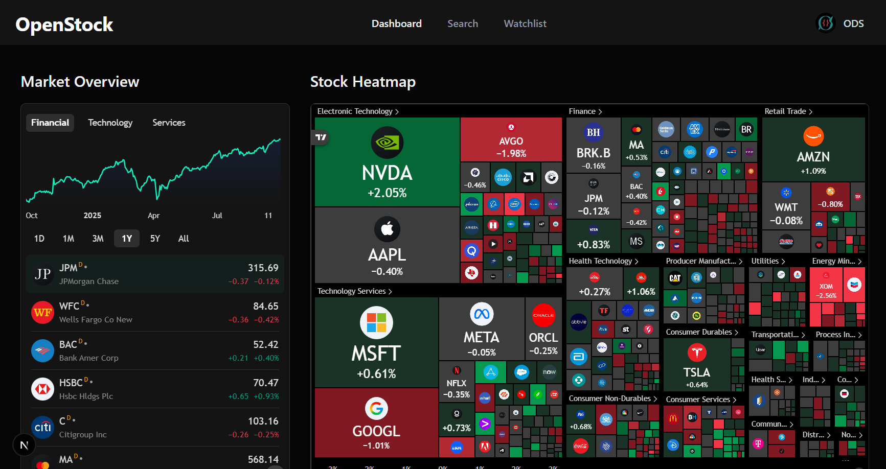

<div align="center">
  <br />
  <a href="#" target="_blank">
    
  </a>
  © Open Dev Society. This project is licensed under AGPL-3.0; if you modify, redistribute, or deploy it (including as a web service), you must release your source code under the same license and credit OpenStock.
  <br />
  <br/>

  <div>
    
    
    
    
    
    
    
    
    
    
    
    
  </div>
</div>

# OpenStock

OpenStock is an open-source alternative to expensive market platforms. Track real-time prices, set personalized alerts, and explore detailed company insights — built openly, for everyone, forever free.

Note: OpenStock is community-built and not a brokerage. Market data may be delayed based on provider rules and your configuration. Nothing here is financial advice.

## 📋 Table of Contents

1. ✨ [Introduction](#introduction)
2. 🌍 [Open Dev Society Manifesto](#manifesto)
3. ⚙️ [Tech Stack](#tech-stack)
4. 🔋 [Features](#features)
5. 🤸 [Quick Start](#quick-start)
6. 🔐 [Environment Variables](#environment-variables)
7. 🧱 [Project Structure](#project-structure)
8. 📡 [Data & Integrations](#data--integrations)
9. 🧪 [Scripts & Tooling](#scripts--tooling)
10. 🤝 [Contributing](#contributing)
11. 🛡️ [Security](#security)
12. 📜 [License](#license)
13. 🙏 [Acknowledgements](#acknowledgements)

## ✨ Introduction

OpenStock is a modern stock market app powered by Next.js (App Router), shadcn/ui and Tailwind CSS, Better Auth for authentication, MongoDB for persistence, Finnhub for market data, TradingView widgets for rich charting, and Inngest for reliable background jobs. It’s designed to be practical for professionals and welcoming for students — no paywalls, no gatekeeping.

## 🌍 Open Dev Society Manifesto <a name="manifesto"></a>

We live in a world where knowledge is hidden behind paywalls. Where tools are locked in subscriptions. Where information is twisted by bias. Where newcomers are told they’re not “good enough” to contribute.

We believe there’s a better way.

- Our Belief: Technology should belong to everyone. Knowledge should be open, free, and accessible. Communities should welcome newcomers with trust, not gatekeeping.
- Our Mission: Build free, open-source projects that make a real difference:
    - Tools that professionals and students can use without barriers.
    - Knowledge platforms where learning is free, forever.
    - Communities where every beginner is guided, not judged.
    - Resources that run on trust, not profit.
- Our Promise: We will never lock knowledge. We will never charge for access. We will never trade trust for money. We run on transparency, donations, and the strength of our community.
- Our Call: If you’ve ever felt you didn’t belong, struggled to find free resources, or wanted to build something meaningful — you belong here.

Because the future belongs to those who build it openly.

## ⚙️ Tech Stack

Core
- Next.js 15 (App Router), React 19
- TypeScript
- Tailwind CSS v4 (via @tailwindcss/postcss)
- shadcn/ui + Radix UI primitives
- Lucide icons

Auth & Data
- Better Auth (email/password) with MongoDB adapter
- MongoDB + Mongoose
- Finnhub API for symbols, profiles, and market news
- TradingView embeddable widgets

Automation & Comms
- Inngest (events, cron, AI inference via Gemini)
- Nodemailer (Gmail transport)
- next-themes, cmdk (command palette), react-hook-form

Language composition
- TypeScript (~93.4%), CSS (~6%), JavaScript (~0.6%)

## 🔋 Features

- Authentication
    - Email/password auth with Better Auth + MongoDB adapter
    - Protected routes enforced via Next.js middleware
- Global search and Command + K palette
    - Fast stock search backed by Finnhub
    - Popular stocks when idle; debounced querying
- Watchlist
    - Per-user watchlist stored in MongoDB (unique symbol per user)
- Stock details
    - TradingView symbol info, candlestick/advanced charts, baseline, technicals
    - Company profile and financials widgets
- Market overview
    - Heatmap, quotes, and top stories (TradingView widgets)
- Personalized onboarding
    - Collects country, investment goals, risk tolerance, preferred industry
- Email & automation
    - AI-personalized welcome email (Gemini via Inngest)
    - Daily news summary emails (cron) personalized using user watchlists
- Polished UI
    - shadcn/ui components, Radix primitives, Tailwind v4 design tokens
    - Dark theme by default
- Keyboard shortcut
    - Cmd/Ctrl + K for quick actions/search

## 🤸 Quick Start

Prerequisites
- Node.js 20+ and pnpm or npm
- MongoDB connection string
- Finnhub API key (free tier supported; real-time may require paid)
- Gmail account for email (or update Nodemailer transport)
- Optional: Google Gemini API key (for AI-generated welcome intros)

Clone and install
```bash
git clone https://github.com/Open-Dev-Society/OpenStock.git
cd OpenStock

# choose one:
pnpm install
# or
npm install
```

Configure environment
- Create a `.env` file (see [Environment Variables](#environment-variables))
- Verify DB connectivity:
```bash
pnpm test:db
# or
npm run test:db
```

Run development
```bash
# Next.js dev (Turbopack)
pnpm dev
# or
npm run dev
```

Run Inngest locally (workflows, cron, AI)
```bash
npx inngest-cli@latest dev
```

Build & start (production)
```bash
pnpm build && pnpm start
# or
npm run build && npm start
```

Open REDACTED_BY_AUDIT to view the app.

## 🔐 Environment Variables

Create `.env` at the project root:

```env
# Core
NODE_ENV=development

# Database
MONGODB_URI=mongodb+srv://<user>:<pass>@<cluster>/<db>?retryWrites=true&w=majority

# Better Auth
BETTER_AUTH_SECRET=your_better_auth_secret
BETTER_AUTH_URL=REDACTED_BY_AUDIT

# Finnhub
FINNHUB_API_KEY=your_finnhub_key
# Optional client-exposed variant if needed by client code:
NEXT_PUBLIC_FINNHUB_API_KEY=
FINNHUB_BASE_URL=REDACTED_BY_AUDIT

# Inngest AI (Gemini)
GEMINI_API_KEY=your_gemini_api_key

# Email (Nodemailer via Gmail; consider App Passwords if 2FA)
NODEMAILER_EMAIL=youraddress@gmail.com
NODEMAILER_PASSWORD=your_gmail_app_password
```

Notes
- Keep private keys server-side whenever possible.
- If using `NEXT_PUBLIC_` variables, remember they are exposed to the browser.
- In production, prefer a dedicated SMTP provider over a personal Gmail.

## 🧱 Project Structure

```
app/
  (auth)/
    layout.tsx
    sign-in/page.tsx
    sign-up/page.tsx
  (root)/
    layout.tsx
    page.tsx
    help/page.tsx
    stocks/[symbol]/page.tsx
  api/inngest/route.ts
  globals.css
  layout.tsx
components/
  ui/…          # shadcn/radix primitives (button, dialog, command, input, etc.)
  forms/…       # InputField, SelectField, CountrySelectField, FooterLink
  Header.tsx, Footer.tsx, SearchCommand.tsx, WatchlistButton.tsx, …
database/
  models/watchlist.model.ts
  mongoose.ts
lib/
  actions/…     # server actions (auth, finnhub, user, watchlist)
  better-auth/…
  inngest/…     # client, functions, prompts
  nodemailer/…  # transporter, email templates
  constants.ts, utils.ts
scripts/
  test-db.mjs
types/
  global.d.ts
next.config.ts          # i.ibb.co image domain allowlist
postcss.config.mjs      # Tailwind v4 postcss setup
components.json         # shadcn config
public/assets/images/   # logos and screenshots
```

## 📡 Data & Integrations

- Finnhub
    - Stock search, company profiles, and market news.
    - Set `FINNHUB_API_KEY` and `FINNHUB_BASE_URL` (default: REDACTED_BY_AUDIT).
    - Free tiers may return delayed quotes; respect rate limits and terms.

- TradingView
    - Embeddable widgets used for charts, heatmap, quotes, and timelines.
    - External images from `i.ibb.co` are allowlisted in `next.config.ts`.

- Better Auth + MongoDB
    - Email/password with MongoDB adapter.
    - Session validation via middleware; most routes are protected, with public exceptions for `sign-in`, `sign-up`, assets and Next internals.

- Inngest
    - Workflows:
        - `app/user.created` → AI-personalized Welcome Email
        - Cron `0 12 * * *` → Daily News Summary per user
    - Local dev: `npx inngest-cli@latest dev`.

- Email (Nodemailer)
    - Gmail transport. Update credentials or switch to your SMTP provider.
    - Templates for welcome and news summary emails.

## 🧪 Scripts & Tooling

Package scripts
- `dev`: Next.js dev server with Turbopack
- `build`: Production build (Turbopack)
- `start`: Run production server
- `lint`: ESLint
- `test:db`: Validate DB connectivity

Developer experience
- TypeScript strict mode
- Tailwind CSS v4 (no separate tailwind.config needed)
- shadcn/ui components with Radix primitives
- cmdk command palette, next-themes, lucide-react icons

## 🤝 Contributing

You belong here. Whether you’re a student, a self-taught dev, or a seasoned engineer — contributions are welcome.

- Open an issue to discuss ideas and bugs
- Look for “good first issue” or “help wanted”
- Keep PRs focused; add screenshots for UI changes
- Be kind, guide beginners, no gatekeeping — that’s the ODS way

## 🛡️ Security

If you discover a vulnerability:
- Do not open a public issue
- Email: opendevsociety@gmail.com
- We’ll coordinate responsible disclosure and patch swiftly

## 📜 License

OpenStock is and will remain free and open for everyone. A formal open-source license will be added to this repository; until then, contributions are accepted under our commitment to openness and transparency.

## 🙏 Acknowledgements

- Finnhub for accessible market data
- TradingView for embeddable market widgets
- shadcn/ui, Radix UI, Tailwind CSS, Next.js community
- Inngest for dependable background jobs and workflows
- Better Auth for simple and secure authentication
- All contributors who make open tools possible

— Built openly, for everyone, forever free. Open Dev Society.

> © Open Dev Society. This project is licensed under AGPL-3.0; if you modify, redistribute, or deploy it (including as a web service), you must release your source code under the same license and credit OpenStock.


## Our Honourable Contributors
- [ravixalgorithm](https://github.com/ravixalgorithm)
- [Priyanshuu00007](https://github.com/Priyanshuu00007)
- [chinnsenn](https://github.com/chinnsenn)

## Special thanks
Huge thanks to [Adrian Hajdin (JavaScript Mastery)](https://github.com/adrianhajdin) — his excellent Stock Market App tutorial was instrumental in building OpenStock for the open-source community under the Open Dev Society. If you found this project helpful, please check out his channel and give him a shoutout for the amazing content!

GitHub: [adrianhajdin](https://github.com/adrianhajdin)
YouTube tutorial: [Stock Market App Tutorial](https://www.youtube.com/watch?v=gu4pafNCXng)
YouTube channel: [JavaScript Mastery](https://www.youtube.com/@javascriptmastery)
